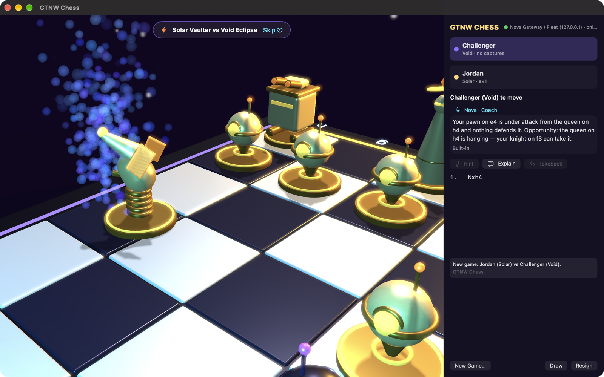
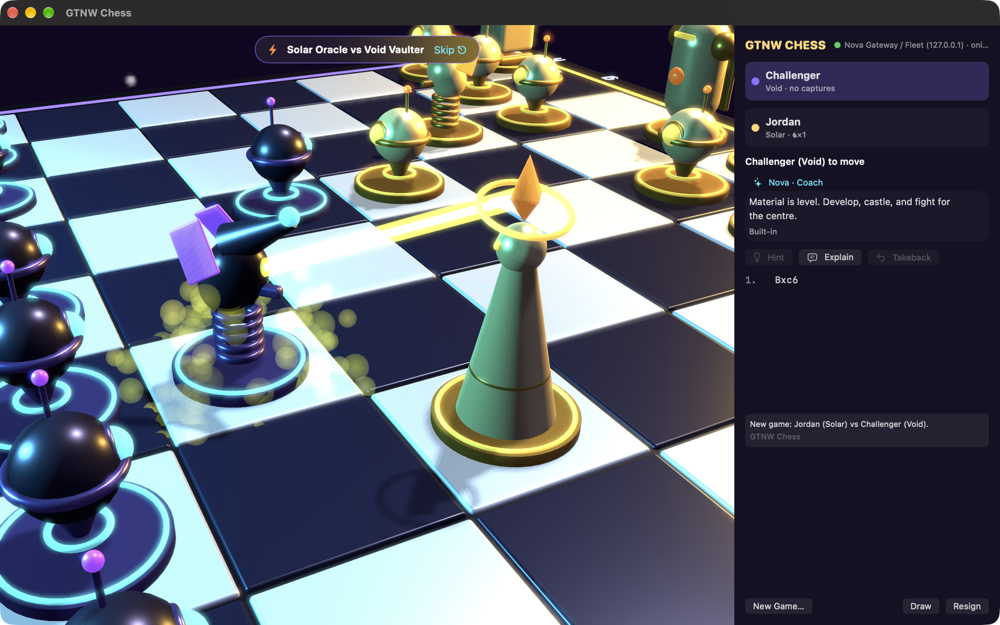
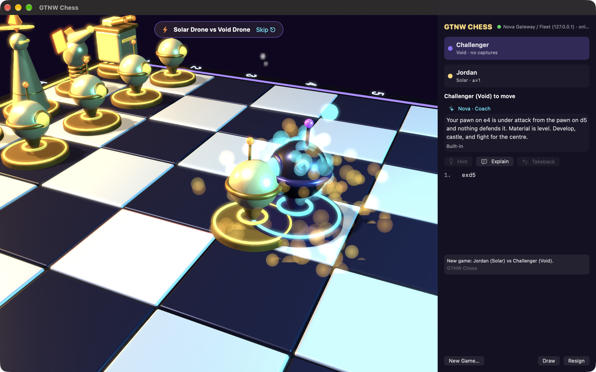
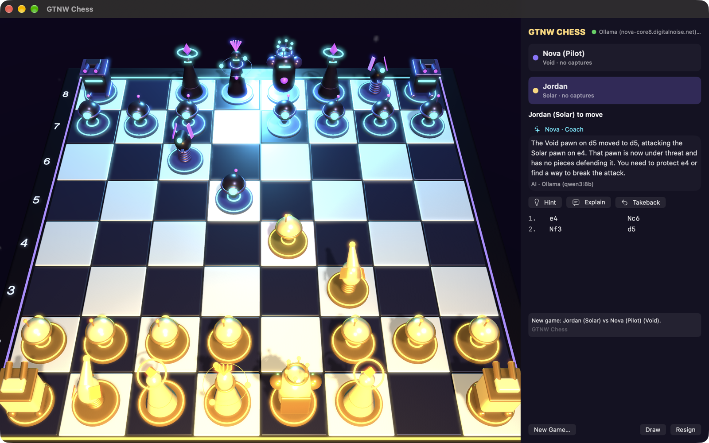
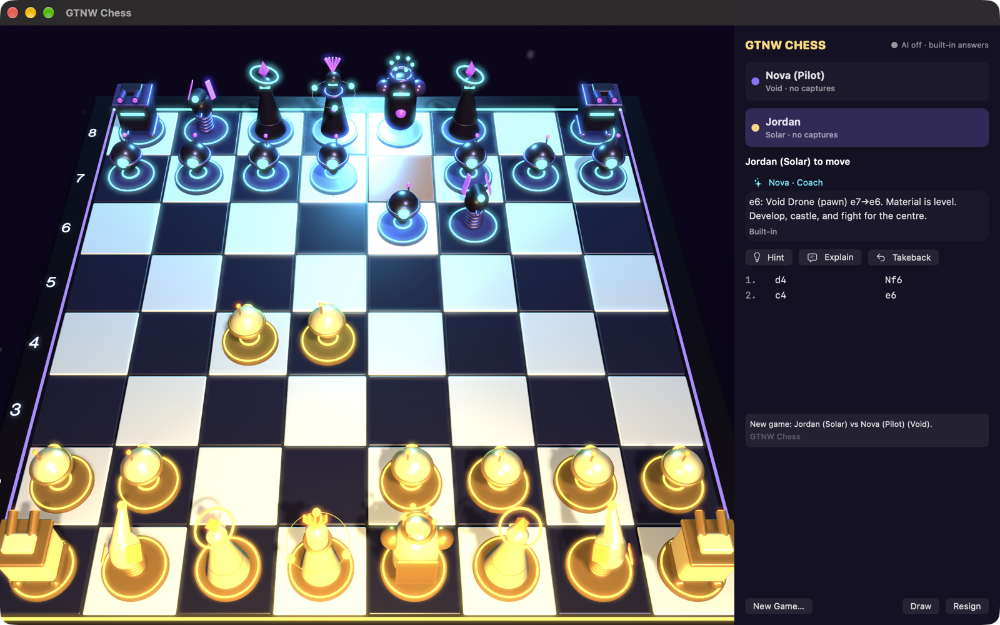
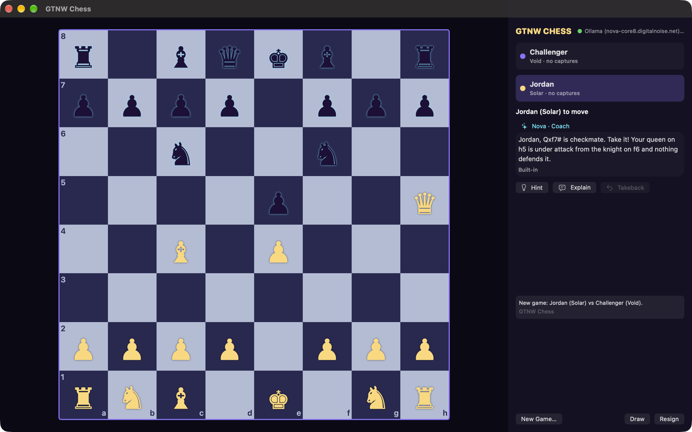
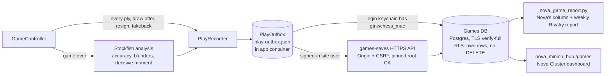
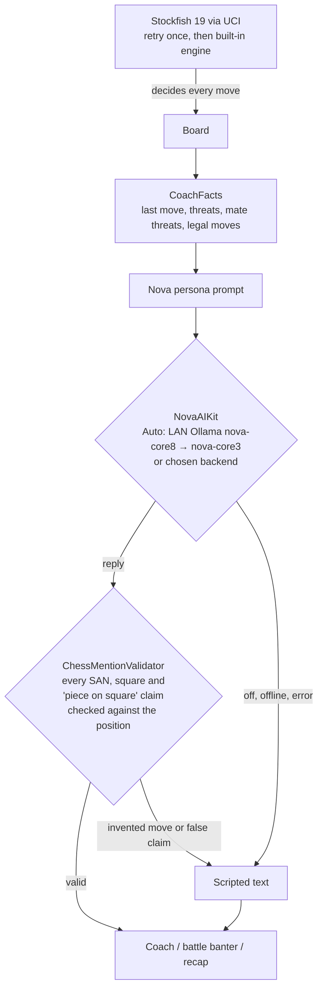
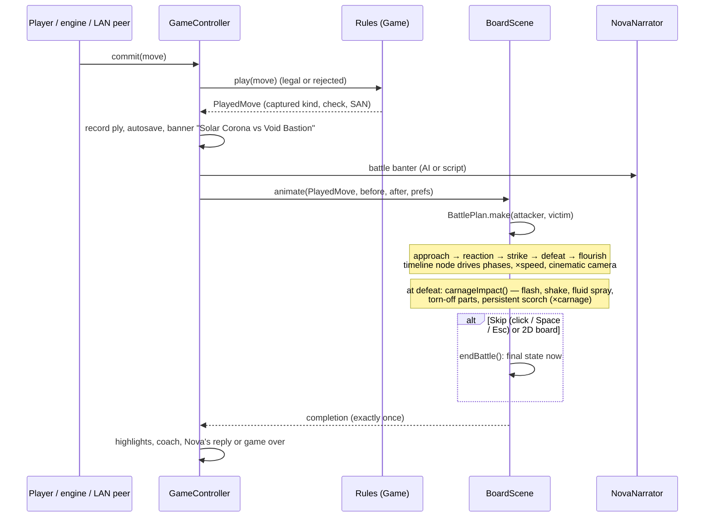

# GTNW Chess


GTNW Chess is a native macOS chess game with animated battles. Two robot fleets, the gold **Solar** fleet (white) and
the violet **Void** fleet (black), play on a 3D board. Every capture is a short battle with its own choreography for
that attacker and victim. Nova, the house AI, is your opponent, your coach and the commentator. Stockfish picks every
move she plays, and the language model only explains and narrates.

Inspired by the classic animated-chess games of the late '80s.


| | |
|---|---|
| Version | **1.0.0** |
| Requires | macOS 14 or later, Apple silicon (arm64) |
| Built with | Swift (5.9 language mode), SwiftUI, AppKit, SceneKit, AVAudioEngine, Network.framework, CryptoKit, Security; one package: [NovaAIKit](https://github.com/kochj23/NovaAIKit) 1.0.0 |
| Engine | Stockfish 19 (GPLv3), bundled as a separate executable; see [Licences](#licences) |
| Author | Jordan Koch ([kochj23](https://github.com/kochj23)) |

## Contents

[Features](#features) · [Screenshots](#screenshots) · [The cast](#the-cast) · [Install](#install) ·
[Playing](#playing) · [LAN play](#lan-play) · [Play history and Nova's reviews](#play-history-and-novas-reviews) ·
[AI](#ai) · [Architecture](#architecture) · [Build](#build) · [Tests](#tests) · [Licences](#licences)

## Features

- **Rules engine written in Swift.** It handles castling, en passant, promotion (with a picker), check, checkmate,
  stalemate, the 50-move rule, threefold repetition and insufficient material. Perft results match the standard
  reference counts for the start position, Kiwipete and positions 3 to 6.
- **FEN and PGN import and export.** The parser handles comments, variations, `;` line comments and NAGs, with size
  and ply limits. Imported games open in study mode.
- **A 3D board in SceneKit.** It renders on Retina with HDR bloom and soft shadows. You can orbit and zoom the camera,
  flip the board, and switch to a flat 2D board (⌥⌘D).
- **36 capture battles, one for each attacker → victim pair.** Each battle has an attack style, the victim's reaction,
  a defeat style and the winner's flourish, and the camera swings in for it. You can skip a battle with a click, Space
  or Esc. Speed runs from 0.5× to 3×, and *Skip animations* turns battles off altogether.
- **Carnage dial** (Settings › Animation: Tame, Brutal, Maximum; Maximum by default). At the kill the board shakes, a
  hit flash goes off, the loser sprays hydraulic fluid and oil and has parts torn off, and a scorch mark stays where it
  died for the rest of the game. A fresh board starts clean.
- **Procedural sound.** Every effect is synthesised at runtime with AVAudioEngine; no audio samples ship.
- **Modes:** play Nova at 8 levels (Cadet to Supernova), hot-seat on one Mac, or LAN play between two Macs. The
  current game saves itself and resumes at the next launch. All state stays inside the app's container.
- **Learning tools:**
  - Legal-move dots and highlighting of pieces under attack.
  - Hints (⌘H) and takebacks (⌘Z).
  - Coach notes on the last move and the threats in the position.
  - A recap at the end of the game with accuracy and the turning point.
- **Chess clock.** The presets range from 3+0 to 30+0. A side that runs out loses on time.
- **Native Mac chrome:**
  - Menus for New Game, Open/Save PGN, Undo, Flip Board, 2D/3D and Full Screen.
  - A Settings window with Graphics, Animation, Sound, Coach, Nova Games, AI and About tabs.
  - Window restoration and an original app icon.

## Screenshots

| | |
|---|---|
|  |  |
|  |  |
|  |  |

## The cast

| Piece | Solar (white) | Void (black) | Attack | Defeat |
|---|---|---|---|---|
| Pawn | Drone | Drone | spark ram | pops into sparks |
| Knight | Vaulter | Vaulter | spring-heeled vault slam | launched on its spring |
| Bishop | Oracle | Oracle | prism beam | prism shatters |
| Rook | Bastion | Bastion | cannon salvo | blocks collapse |
| Queen | Corona | Eclipse | satellite strike | stardust spiral |
| King | Regent | Regent | gravity crush | crown falls (checkmate finale) |

The victim's reaction and the attacker's flourish change with the pair, so no two of the 36 battles play the same way.
A test checks that all 36 are distinct.

## Install

1. Open `GTNWChess-v1.0.0-buildN.dmg` and drag **GTNW Chess** to Applications.
2. The app is signed ad hoc, not with a Developer ID. On the first launch, right-click the app in Applications, choose
   **Open**, then click **Open** again.
3. Optional: on Jordan's Macs on the LAN, run
   `"/Applications/GTNW Chess.app/Contents/MacOS/GTNW Chess" --setup-credentials` once. It fetches the play-history
   role password over SSH into the login Keychain (`nova-games-pg` / `gtnwchess_mac`). Other Macs sign in to Nova
   Games from the app instead.

## Playing

| Action | How |
|---|---|
| Move | Click a piece, then a target. Legal targets show as dots. |
| Orbit / zoom | Drag / scroll on the 3D board. ⌘0 resets the camera. |
| Skip a battle | Click, Space or Esc |
| Hint / takeback | ⌘H / ⌘Z (no takebacks in LAN games) |
| Flip board, 2D/3D, full screen | ⌥⌘F, ⌥⌘D, ⌃⌘F |
| Offer a draw, resign | **Game** menu |

Nova accepts a draw only after move 10 and only when her own evaluation is no better than +0.3.

## LAN play

One Mac hosts the game (File › Host LAN Game…) and shows a 6-digit pairing code. The other Mac finds it over Bonjour
(`_gtnwchess._tcp`), or connects by address, and enters the code.

- **Transport:** TLS 1.2 with a pre-shared key, `TLS_PSK_WITH_AES_128_GCM_SHA256`. The key is
  HKDF-SHA256(code, salt `gtnwchess-lan-v1`), so a wrong code never completes the handshake. Messages are
  length-prefixed JSON frames of at most 64 KB.
- **Refereeing:** each Mac checks every incoming move against its own rules engine. Wrong ply, wrong turn, illegal
  moves, and moves after the game ended are all rejected, and the two Macs resync from the host's state.
- **Reconnect:** a guest that drops reconnects with exponential backoff and resumes the same game. The game also
  survives quitting and relaunching on either Mac.
- **In-game:** an optional clock, draw offers, resignation, and flag-fall (called by the flagged side's own Mac).
- **Players:** each player's display name defaults to their macOS first name, and each Mac coaches only its own player.

## Play history and Nova's reviews

Every finished game is written to the shared Nova Games play history as game `gtnwchess`. Each **game is one
session**: in a LAN game only the host writes it, and the guest writes nothing. Writing never blocks play, because
each write goes to a local queue in the app container first and is sent from there.



- **Session data:**
  - Players, result, termination, opening (ECO), move count and duration.
  - Captures by piece type, checks, a material graph, and the PGN.
  - Stockfish analysis: accuracy, average centipawn loss, blunders, mistakes and inaccuracies, the biggest swing, and
    the decisive moment.
- **Events:**
  - One `ply` event per move, plus `takeback`, `draw_offer` and `resign`.
  - A `move` event per move with SAN, UCI, the evaluation before and after, the classification and the clock.
  - A final `game_over`.
- **Classification:** each move is classified by the drop in win percentage, Lichess-style: best, good, inaccuracy
  (10 or more), mistake (20 or more), blunder (30 or more).
- **Privacy:** Jordan's own games are written as player `default`, and an opponent's display name appears only in the
  summary. The *Name me in Nova's reviews* toggle (Settings › Nova Games) is **off** by default and is stored on the
  player's Nova Games account. While it is off, Nova's columns call that player "the challenger".
- **Signing in on other Macs:** a Mac without the database role signs in to Nova Games on the first run. The password
  is kept only in that Mac's Keychain (`com.jkoch.gtnwchess.gamessite`). Until the player signs in, results wait in
  the queue.

## AI

All AI goes through [NovaAIKit](https://github.com/kochj23/NovaAIKit) 1.0.0. NovaAIKit provides:

- AI on/off, and backend, model and URL pickers.
- A status indicator.
- Automatic failover between Ollama endpoints.
- Keys stored only in the Keychain (`com.jkoch.gtnwchess.*`) and sent only over https.
- A built-in scripted fallback for every feature.



The language model writes the coach notes, the battle banter between pieces, and the end-of-game recap, which roasts
the moves and never the people. Stockfish picks every move Nova plays. The game checks every move or square the model
mentions against the real position and falls back to the scripted line if anything doesn't match. The default
backend is the LAN fleet's Ollama, and the app ships no keys.

## Architecture

```mermaid
flowchart TB
    subgraph UI[SwiftUI + AppKit]
      CV[ContentView / SidePanel / Sheets]
      SV[SettingsView + NovaAISettingsView]
      B3[Board3DView: SCNView] & B2[Board2DView]
    end
    GC[GameController<br/>@MainActor] --> CV
    CV --> GC
    GC --> CH[Chess: Position, Game, SAN, FEN, PGN, Openings]
    GC --> EN[EngineService<br/>UCIEngine (Stockfish) + FallbackEngine]
    GC --> BS[BoardScene<br/>PieceFactory, BattlePlan, Effects]
    GC --> AU[SoundPlayer + Synth]
    GC --> AI[NovaNarrator → NovaAIKit]
    GC --> LAN[LANSession<br/>Bonjour + TLS-PSK]
    GC --> REC[PlayRecorder → PlayOutbox → PGPlaySink / SitePlaySink]
    GC --> ST[GameStore<br/>current-game.json]
    B3 --> BS
```

The capture-animation pipeline:



## Build

You need Xcode 16 or later, [XcodeGen](https://github.com/yonaskolb/XcodeGen) and Stockfish for the bundle step
(`brew install stockfish`, or run `scripts/fetch-stockfish.sh`).

```sh
xcodegen generate
xcodebuild -project GTNWChess.xcodeproj -scheme GTNWChess -configuration Release -derivedDataPath ./dd build
```

The post-build script `scripts/bundle-stockfish.sh` copies the engine to `Contents/MacOS/stockfish`. Its licence, the
authors list and the source offer go to `Contents/Resources/Stockfish/`. Release builds compile with zero warnings.

## Tests

```sh
xcodebuild -project GTNWChess.xcodeproj -scheme GTNWChess -derivedDataPath ./dd test
```

The suites cover all seven categories:

| Category | What it covers |
|---|---|
| Unit | Perft (6 positions), FEN, SAN, castling, en passant, promotion, every draw rule, PGN, openings, win%/accuracy/classification, UCI parsing, battle plans, cast, coach facts, AI validator, clocks, recorder payloads, LAN codec, referee, consent form |
| Security | Keychain naming, no key over http, no shipped keys, UCI/FEN/PGN injection and size limits, LAN frame limits, PSK per code, referee rejects out-of-turn, illegal and stale moves, site sign-in validation, Origin/CSRF, consent OFF never sends a name, a source scan for secrets and household names, bundled CAs |
| Performance | Perft budget, move generation throughput, PGN round trip, coach facts per move, engine response, synth, scene sync, summary size |
| Retry | Backoff maths, outbox (transient kept, permanent dropped, order, persistence, cap), engine retry → fallback, illegal engine reply, AI retry and fallback, LAN reconnect giving up cleanly |
| Integration | Real Stockfish (skipped if absent), TLS-PSK LAN on loopback incl. wrong code and reconnect, play history against a throwaway TLS Postgres 17 with NovaGames `play.sql` (RLS, no DELETE, idempotent writes) |
| Functional | Hot-seat and vs-Nova games to the end with history, takeback, draws, resignation, promotion, save/resume, PGN study mode, engine vs engine, AI narration with fallback, two-controller LAN games (only the host writes) |
| Frame / UI state | 32 piece nodes, node reuse, highlights, camera limits, battle start/skip-once/run-to-end under an offscreen renderer, non-blank offscreen frames, 2D/3D and flip state |

## Licences

- **GTNW Chess:** MIT ([LICENSE](LICENSE)).
- **Stockfish 19:** GNU GPL v3. It ships unmodified as a separate executable. The full licence and a written source
  offer are in the app (Settings › About and `Contents/Resources/Stockfish/`). The source is at
  <https://github.com/official-stockfish/Stockfish/tree/sf_19>.
- **Art, animation, sound and characters:** all original to this project and made procedurally at runtime.
